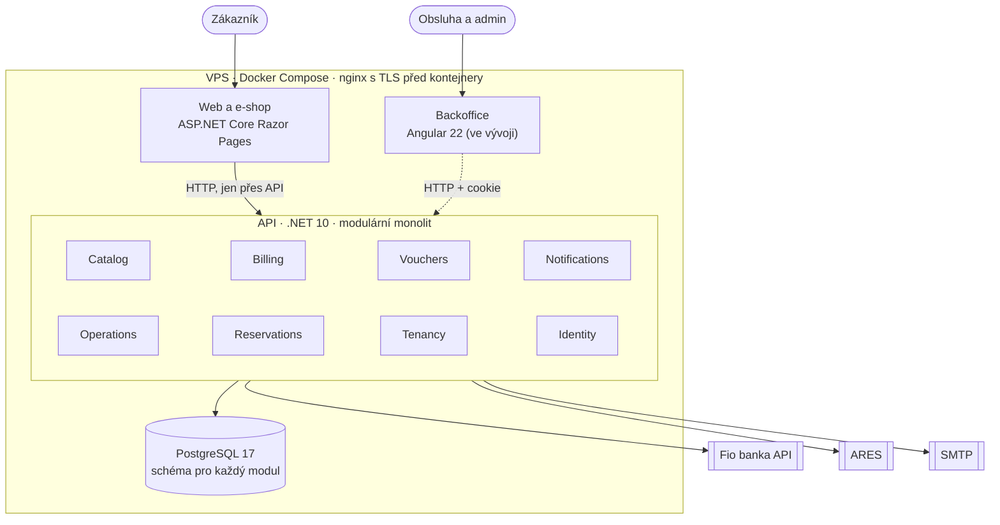

# Architektura WakeParku

Stav k 26. 10. 2026. Jeden systém pro provoz wakeparku: veřejný web s e-shopem, API
s osmi moduly nad jednou databází a backoffice ve vývoji. Běží v Dockeru na jednom VPS,
nasazuje se automaticky po zelených testech. Důvody jednotlivých rozhodnutí jsou v [ADR](adr/).

## Frontend: dva nástroje pro dva druhy uživatelů

| | Veřejný web a e-shop | Backoffice |
|---|---|---|
| Technologie | ASP.NET Core **Razor Pages** | **Angular 22** (zoneless, standalone komponenty) |
| Uživatel | anonymní návštěvník, poprvé | přihlášená obsluha a admin, každý den |
| Důležité | rychlé první načtení, vyhledávače, funguje bez JavaScriptu | hodně interakce, rychlá odezva, mobil u vody se slabým signálem |
| Stav | v provozu na testovací doméně | přihlášení a seznam areálů; obrazovky katalogu a kalendáře se staví |

**Web** je vykreslený na serveru, JavaScript jen doplňuje pohodlí (počet kusů, kopírování,
dohledání firmy v ARES). Přísné CSP povoluje jen vlastní skripty, obsah je česky i anglicky
(`/en/…`). S databází web nekomunikuje: všechno jde přes API. Hlídá to architektonický test
(`StorefrontIsolationTests`), takže web nemůže obejít pravidla backendu.

**Backoffice** je aplikace v prohlížeči. Obsluha s ní pracuje celý den na mobilu u vody,
kde signál vypadává. Aplikace v prohlížeči zvládne chvilkový výpadek, stránky vykreslované
na serveru ani Blazor Server ne. Cena jsou dva frontendové stacky. Typy pro Angular se budou
generovat z OpenAPI popisu API, aby se nerozcházely.

## Backend: modulární monolit

Jedna aplikace, jedno nasazení, jedna databáze, ale moduly oddělené tak přísně jako
samostatné služby ([ADR 0001](adr/0001-modularni-monolit.md)).

| Modul | Odpovídá na otázku | Hlavní pojmy |
|---|---|---|
| `Catalog` | Co se prodává a za kolik? | produkt, kategorie, ceník s cenami od data |
| `Billing` | Kdo co objednal, zaplatil a s jakým dokladem? | objednávka, bankovní pohyb, daňový doklad |
| `Vouchers` | Jaké poukazy jsou vydané? | voucher s kódem |
| `Notifications` | Co komu odešlo? | fronta e-mailů, PDF |
| `Operations` | Kdy a kde se jezdí? | vlek, provozní den, blokace |
| `Reservations` | Co je volné a kdo to má? | slot, rezervace, permanentka |
| `Tenancy` | Kdo systém provozuje a kde? | provozovatel, areál |
| `Identity` | Kdo je to a co smí? | účet, role, oprávnění |

Každý modul má čtyři projekty (`Domain`, `Application`, `Contracts`, `Infrastructure`),
vlastní schéma v databázi a vlastní migrace. Pravidla, která drží hranice:

- **Modul smí znát jen `Contracts` jiného modulu**, nikdy jeho vnitřek. Porušení shodí build
  (NetArchTest v `WakePark.ArchitectureTests`).
- **Synchronně** přes rozhraní v kontraktech: Billing čte ceny přes `ICatalogReader`,
  Reservations rozvrh přes `IOperationsSchedule`.
- **Asynchronně** přes integrační události a **outbox**: `OrderPaid` z Billingu vyvolá vydání
  voucherů, `VouchersIssued` z Vouchers odeslání e-mailu s PDF. Událost se uloží ve stejné
  transakci jako změna, dispatcher ji doručí alespoň jednou s exponenciálním čekáním mezi
  pokusy. Příjemci jsou idempotentní.
- **Data provozovatele** se omezují v aplikační vrstvě podle přihlášení, cizí záznam vypadá
  jako neexistující ([ADR 0007](adr/0007-omezeni-dat-na-provozovatele.md)).

### Proč monolit, a ne mikroslužby

- **Transakce, kde na nich záleží.** Spárovaná platba a daňový doklad vznikají v jedné
  transakci. Zaplacená objednávka bez dokladu tak vzniknout nemůže a není potřeba sága ani
  kompenzace.
- **Jedno nasazení a nízké náklady.** Celý systém (web, API a databáze) běží na VPS
  s 1 vCPU a 2 GB RAM, každý kontejner s limitem 256 MB.
- **Hranice jsou připravené.** Moduly spolu mluví jen přes kontrakty a události. Kdyby jeden
  potřeboval škálovat zvlášť, oddělí se bez přepisování ostatních. Do té doby nikdo neplatí
  za síť, distribuované transakce a provoz deseti služeb.

## Data

- **PostgreSQL 17**, Entity Framework Core 10 code-first, migrace verzované v repu a spouštěné
  jako samostatný krok nasazení, nikdy při startu aplikace.
- **Vícejazyčné texty** v `jsonb` (`{"cs": …, "en": …}`), nový jazyk tedy neznamená migraci.
- **Čas a peníze** ([ADR 0004](adr/0004-cas-a-penize.md)): okamžiky v UTC, provozní doba
  v lokálním čase areálu, přechod na letní čas ošetřený a otestovaný; částky `decimal`.
- **Číselné řady** objednávek a dokladů bez mezer (zámek řádku čítače v transakci).
- **Inbox pro banku:** pohyby z Fio s unikátním ID, opakované stažení nic nezdvojí.

## Napojení na okolní svět

| Služba | K čemu | Jak |
|---|---|---|
| Fio banka API | párování plateb | každou minutu pohyby za 7 dní, párování podle variabilního symbolu |
| QR platba (SPAYD) | platba převodem bez platební brány | QR kód na stránce objednávky |
| ARES | údaje firmy podle IČO | přes API, odpovědi v paměti 24 h |
| SMTP (MailKit) | potvrzení, vouchery, upomínky | fronta e-mailů s opakováním, SPF a DMARC na doméně |
| QuestPDF | vouchery a daňové doklady v PDF | komunitní licence, za vlastním rozhraním |

## Testy

323 automatických testů, spouští je CI u každé změny:

| Druh | Počet | Co ověřují |
|---|---|---|
| Unit testy domény a aplikační vrstvy | 218 | pravidla bez databáze, tedy rychle |
| Integrační testy | 40 | proti skutečnému PostgreSQL a poštovnímu serveru (Testcontainers, Mailpit), včetně HTTP API s přihlášením |
| Testy webu | 59 | stránky, formuláře, překlady, výpadek API |
| Architektonické testy | 6 | směr závislostí a izolace modulů |

## Docker

- **Multi-stage build:** SDK obraz staví, do produkce jde jen runtime `aspnet:10.0`.
  Kontejnery běží **pod neprivilegovaným uživatelem**.
- **Docker Compose na VPS:** `db`, `api`, `storefront`. Databáze ani API nemají
  veřejný port, ven vede jen web přes nginx hostitele s TLS (Let's Encrypt).
- **Tajné údaje** (heslo databáze, token banky, SMTP) jen v `.env` na serveru, nikdy v repu
  ani v logu.

## CI/CD (GitHub Actions)

1. **Build a testy:** backend (všech 323 testů včetně integračních v kontejnerech) a frontend.
2. **Obrazy:** API a web se postaví a nahrají do GitHub Container Registry, značené hashem commitu.
3. **Nasazení:** SSH na VPS s klíčem, který smí spustit jen nasazovací skript, nic jiného.
   Skript projde kroky databáze → migrace → základní data → katalog → nové kontejnery →
   kontrola, že web ukazuje nabídku.
4. **Bezpečně při chybě:** když selže migrace nebo import, nové kontejnery se nespustí a dál
   běží stará verze. Návrat ke starší verzi = spustit skript s jejím hashem.

## Bezpečnost

- CSP bez inline skriptů, ochrana proti CSRF (antiforgery token v hlavičce), omezení počtu
  objednávek a dotazů na ARES z jedné IP.
- Přihlášení cookie `HttpOnly` a `Secure`, oprávnění se čtou z databáze při každém požadavku,
  odebraná role tedy platí hned.
- Osobní údaje u plateb, které se e-shopu netýkají, se nedrží.

## Provoz

- **Zálohy:** denní `pg_dump` na serveru (14 dní zpětně) a denní kopie na počítač mimo server.
- **Dohled:** externí kontrola dostupnosti, upozornění e-mailem. Problémy, které vyžadují
  člověka (nespárovaná platba, nedoručený e-mail, nedoručená událost), přijdou na info@.

## Vědomé kompromisy

- **Jeden VPS = jedno místo selhání.** Pro sezónní provoz malého areálu přiměřené, data jsou
  zálohovaná mimo server. Kubernetes ani cloud záměrně ne: náklady a složitost by tu převýšily
  přínos.
- **YARP gateway** (`WakePark.Gateway`) je v kódu připravená, ale vědomě nenasazená: backoffice
  publikuje nginx na stejném originu jako API ([ADR 0010](adr/0010-gateway-zatim-ne-backoffice-pres-nginx.md)).
- **Dva frontendové stacky** (viz výše).
- **Pilot pro jeden park** ([ADR 0008](adr/0008-backoffice-mapa-modulu.md)): data jsou
  oddělená po provozovatelích, ale obecná nastavení pro víc parků se začnou stavět až po
  sezóně 2027.
